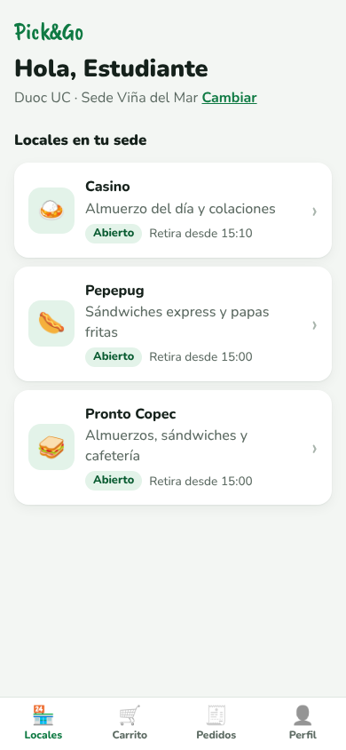
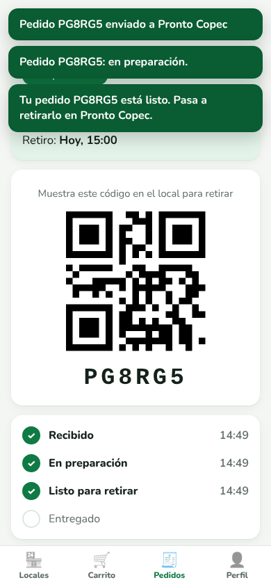
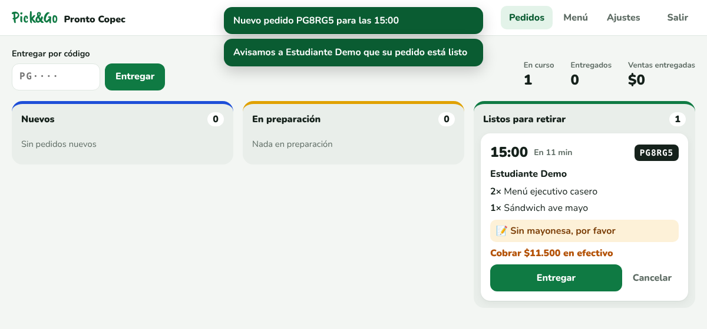

# Pick&Go

**Pides, lo retiras y te vas.** Pick&Go es una app para estudiantes de universidades e institutos de Chile: pides en los
locales de tu sede, eliges a qué hora retiras y el local recibe el pedido al instante para tenerlo listo a esa hora.
Así no pierdes en la fila los 10 minutos que tienes para comer.

| Locales de la sede | Carrito y hora de retiro | Pedido listo | Panel del local |
| --- | --- | --- | --- |
|  |  |  |  |

## Qué hace

**Para estudiantes**

- Registro con correo y sede. Las sedes se agrupan por institución, así que sirve para cualquier casa de estudios.
- Menú de cada local por categorías, con productos agotados marcados.
- Hora de retiro en franjas de 10 minutos, para hoy o para mañana. Cada franja tiene cupo: cuando se llena, se elige
  otra, y así la demanda del horario peak se reparte.
- Pago con tarjeta, tarjeta JUNAEB o efectivo al retirar (ver [Limitaciones](#limitaciones)).
- Seguimiento en vivo: recibido, en preparación, listo y entregado, con aviso cuando el pedido está listo.
- Código de retiro con QR, historial y "repetir este pedido".

**Para locales**

- Tablero en vivo con los pedidos ordenados por hora de retiro, con aviso sonoro cuando entra uno nuevo.
- Un botón por paso: empezar a preparar, marcar listo (avisa al estudiante) y entregar. También se entrega
  escribiendo el código del pedido.
- Menú editable: productos, precios, categorías y disponibilidad.
- Ajustes de horario, cupo por franja, anticipación mínima y pausa de pedidos.
- Cualquier local puede registrarse solo desde la pantalla de ingreso.

## Cómo correrlo

Necesitas [Node.js](https://nodejs.org) 22.13 o superior.

```bash
npm install
```

```bash
npm run dev
```

Abre <http://localhost:5173>. La primera vez se crea la base de datos con datos de demostración.

Para probar los avisos en vivo, entra como estudiante en una ventana y como local en otra (por ejemplo, una ventana
de incógnito). La pantalla de ingreso tiene botones para entrar con las cuentas de prueba:

| Rol | Correo | Contraseña |
| --- | --- | --- |
| Estudiante | `estudiante@pickgo.cl` | `pickgo123` |
| Local (Pronto Copec) | `copec@pickgo.cl` | `pickgo123` |
| Local (Pepepug) | `pepepug@pickgo.cl` | `pickgo123` |
| Local (Casino) | `casino@pickgo.cl` | `pickgo123` |

### Otros comandos

| Comando | Qué hace |
| --- | --- |
| `npm test` | Corre las pruebas del servidor |
| `npm run build` | Revisa tipos y compila la app web en `dist/` |
| `npm start` | Sirve la API y la app compilada en un solo puerto (3001) |

### Variables de entorno

| Variable | Por defecto | Para qué sirve |
| --- | --- | --- |
| `PORT` | `3001` | Puerto del servidor |
| `PICKGO_DB` | `data/pickgo.db` | Archivo de la base de datos SQLite |
| `PICKGO_DEMO` | activado | Con `0` arranca sin datos ni cuentas de demostración |
| `TRUST_PROXY` | sin definir | Defínela si el servidor queda detrás de un proxy con HTTPS |

## Cómo está hecho

- **`server/`**: API en Node.js con Express y SQLite (`node:sqlite`, sin dependencias nativas). Los avisos en vivo
  usan Server-Sent Events. Las sesiones van en una cookie `HttpOnly` y las contraseñas se guardan con scrypt.
- **`src/`**: app web en React y TypeScript, compilada con Vite. Está pensada para el celular y se puede agregar a la
  pantalla de inicio.

Las horas de retiro se calculan siempre en hora de Chile. El servidor valida precios, disponibilidad, horarios y cupos
al crear cada pedido, así que no depende de lo que mande el navegador.

## Limitaciones

Esta versión es un MVP funcional. Lo que falta para usarlo con locales reales:

- **Los pagos son simulados.** Tarjeta y JUNAEB marcan el pedido como pagado sin cobrar nada. Falta integrar una
  pasarela, como Webpay.
- **Los avisos requieren tener la app abierta.** Llegan dentro de la app y como notificación del navegador mientras
  haya una pestaña abierta. Para avisar con la app cerrada falta implementar notificaciones push.
- **El QR muestra el código, pero el panel no lo escanea con la cámara.** El local escribe el código o toca
  "Entregar" en el pedido.
- **Las instituciones y sedes se cargan desde `server/seed.js`.** Todavía no hay una pantalla de administración para
  crearlas.
- Los menús y precios de demostración son de ejemplo.

Quedaron fuera, igual que en el informe del proyecto: lockers inteligentes, predicción de demanda, programa de puntos
y entrega dentro del campus.
