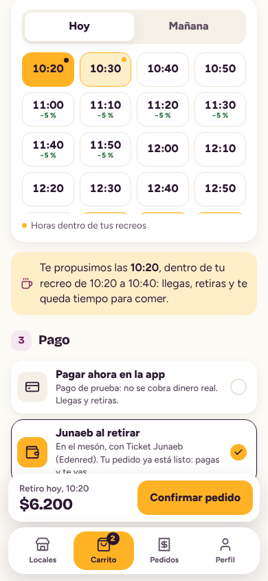
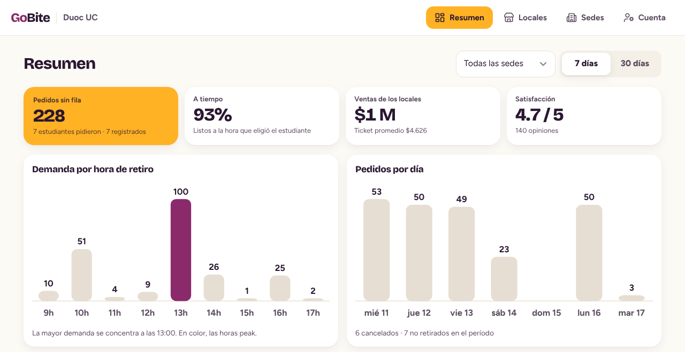

# Pick&Go

**Pides. Retiras. Te vas.** Pick&Go es una app para estudiantes de universidades e institutos de Chile: pides en los
locales de tu sede, eliges a qué hora retiras y el local recibe el pedido al instante para tenerlo listo a esa hora.
Así no pierdes en la fila los 10 minutos que tienes para comer.

| Inicio | Carrito y hora de retiro | Pedido listo |
| --- | --- | --- |
|  |  |  |

| Panel del local | Panel de la institución |
| --- | --- |
|  |  |

## Qué hace

**Estudiantes**

- Registro con correo y sede; las sedes se agrupan por institución.
- Locales ordenados por la hora más cercana en que se puede retirar, con buscador de productos.
- Hora de retiro en franjas de 10 minutos, para hoy o mañana. Cada franja tiene cupo, así la demanda del horario
  peak se reparte.
- Productos con foto y opciones (tamaños, agregados), con el precio calculado al elegir.
- Se pide en la app y se paga en el local al retirar; la app todavía no cobra.
- Seguimiento en vivo y aviso cuando el pedido está listo, también con la app cerrada.
- Código de retiro con QR, historial, «pedir lo de siempre» y calificación del local.
- Perfil con cambio de sede, apariencia clara u oscura, ayuda, descarga de datos y eliminación de cuenta.

**Locales**

- Tablero en vivo con los pedidos ordenados por hora de retiro y aviso sonoro al entrar uno nuevo.
- Un botón por paso: empezar a preparar, avisar que está listo y entregar. Se entrega escaneando el QR con la cámara
  o escribiendo el código.
- Cada pedido nuevo se acepta o se rechaza; el estudiante se entera al instante.
- Menú editable con foto, ícono y opciones por producto (todos opcionales), horarios, cupo por franja,
  anticipación mínima y pausa de pedidos.
- Métricas: ventas, puntualidad, calificación, demanda por hora, productos más pedidos y opiniones.
- Si un pedido no se retira, se marca; con tres en 30 días, esa cuenta no puede hacer pedidos nuevos.

**Instituciones**

- Resumen con pedidos, puntualidad, ventas y satisfacción, por sede y por período, exportable a CSV.
- Aprobación de locales: un local nuevo no aparece para los estudiantes hasta que la institución lo aprueba.
- Creación de sedes.

**Plataforma** (quien opera Pick&Go)

- Crea instituciones con su primera sede y su cuenta de administración.
- Recupera el acceso de quien olvidó su contraseña, con una clave temporal.

## Cómo correrlo

Necesitas [Node.js](https://nodejs.org) 22.13 o superior.

```bash
npm install
```

```bash
npm run dev
```

Abre <http://localhost:5173>. La primera vez se crea la base de datos con datos de demostración, incluido un
historial de pedidos de la última semana para que las métricas tengan contenido.

La pantalla de ingreso tiene botones para entrar con las cuentas de prueba. Todas usan la contraseña `pickgo123`:

| Rol | Correo |
| --- | --- |
| Estudiante | `estudiante@pickgo.cl` |
| Local (Pronto Copec) | `copec@pickgo.cl` |
| Local (Pepepug) | `pepepug@pickgo.cl` |
| Local (Casino) | `casino@pickgo.cl` |
| Institución (Duoc UC) | `admin@pickgo.cl` |
| Plataforma | `plataforma@pickgo.cl` |

Para ver los avisos en vivo, abre el estudiante y el local en ventanas distintas (una de incógnito).

Los avisos push y la instalación como app solo funcionan en la versión compilada (`npm run build` y `npm start`)
y con HTTPS o en `localhost`.

### Comandos

| Comando | Qué hace |
| --- | --- |
| `npm run dev` | Servidor y app web en modo desarrollo |
| `npm test` | Pruebas del servidor |
| `npm run build` | Revisa tipos y compila la app web en `dist/` |
| `npm start` | Sirve la API y la app compilada en un solo puerto (3001) |
| `npm run crear-admin -- "Institución" correo@institucion.cl` | Crea una institución y su administración desde la terminal |

### Variables de entorno

| Variable | Por defecto | Para qué sirve |
| --- | --- | --- |
| `PORT` | `3001` | Puerto del servidor |
| `PICKGO_DB` | `data/pickgo.db` | Archivo de la base de datos SQLite |
| `PICKGO_DEMO` | activado | Con `0` arranca sin datos ni cuentas de demostración |
| `PICKGO_OWNER_EMAIL` y `PICKGO_OWNER_PASSWORD` | sin definir | Crean la cuenta de plataforma al arrancar, si no existe |
| `TRUST_PROXY` | sin definir | Defínela si el servidor queda detrás de un proxy con HTTPS |
| `PICKGO_VAPID_SUBJECT` | `mailto:soporte@example.com` | Contacto del operador que exigen los servicios de push; usa uno real en producción |

## Operar con instituciones reales

1. Arranca con `PICKGO_DEMO=0` y define `PICKGO_OWNER_EMAIL` y `PICKGO_OWNER_PASSWORD`. La base parte vacía, con
   solo tu cuenta de plataforma.
2. Entra con esa cuenta y crea la institución: la app te muestra una vez el correo y la contraseña temporal de su
   administración.
3. La administración entra, cambia su contraseña y crea las sedes que falten.
4. Cada local se registra solo desde «Súmalo a Pick&Go» y la administración lo aprueba.
5. Los estudiantes se registran solos eligiendo su sede.

La base de datos es un archivo SQLite (`PICKGO_DB`). Cada día se guarda una copia en la carpeta `respaldos`, junto
a la base, y se conservan las últimas siete. Guarda ese archivo en un disco que no se borre.

## Publicarla

El archivo `render.yaml` permite publicarla en [Render](https://render.com). Tal como viene usa el plan gratuito con
datos de demostración, que **se pierden cada vez que el servicio se duerme**: sirve para mostrar la app, no para
operar. Para conservar cuentas y pedidos hace falta un plan con disco persistente; el mismo archivo explica qué
líneas activar.

## Cómo está hecho

- **`server/`**: API en Node.js con Express y SQLite (`node:sqlite`, sin dependencias nativas). Los avisos en vivo
  usan Server-Sent Events y las notificaciones con la app cerrada usan Web Push.
- **`src/`**: app web en React y TypeScript, compilada con Vite. Es instalable (PWA) y está pensada para el celular.

Las horas de retiro se calculan siempre en hora de Chile. El servidor valida precios, disponibilidad, horarios y
cupos al crear cada pedido, así que no depende de lo que mande el navegador.

### Seguridad

- Contraseñas guardadas con scrypt; se rechazan las más comunes.
- Sesiones en cookie `HttpOnly` y `SameSite`; en la base solo se guarda el hash del token.
- Bloqueo de la cuenta tras 8 intentos fallidos y topes de solicitudes.
- Las acciones solo se aceptan desde la propia app (verificación de origen contra CSRF).
- Política de seguridad de contenido (CSP) estricta y cabeceras contra incrustación y detección de tipos.
- Cada rol accede solo a lo suyo: un local no ve pedidos de otro y una institución no ve locales de otra.
- Cambiar la contraseña cierra las demás sesiones; el estudiante puede descargar sus datos y eliminar su cuenta.
- Las suscripciones push solo se aceptan de los servicios de notificación de los navegadores.

## Limitaciones

Lo que falta o conviene saber antes de operar a gran escala:

- **La app no cobra.** Se pide en la app y se paga en el local. Integrar pagos (por ejemplo Webpay) requiere
  credenciales de comercio.
- **No hay verificación de correo ni recuperación de contraseña por correo.** Ambas necesitan un servicio de envío
  de correos. Mientras tanto, la plataforma puede generar una contraseña temporal para cualquier cuenta.
- **Las notificaciones push no se han probado en dispositivos reales**, y la app no se ha probado en iPhone ni
  Safari; las pruebas automáticas corren en Chromium.
- **En iPhone los avisos push exigen instalar la app** en la pantalla de inicio (requisito de iOS).
- **Un solo servidor con SQLite.** Sirve para pilotos; para muchas sedes a la vez conviene pasar a una base de datos
  administrada.
- Los menús, precios e historial de demostración son inventados.

Quedaron fuera, igual que en el informe del proyecto: lockers inteligentes, predicción de demanda, programa de
puntos y entrega dentro del campus.
